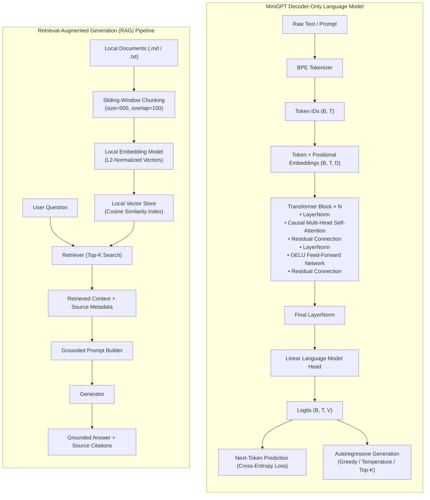

# MiniGPT

**MiniGPT** is a small, self-contained educational decoder-only Transformer language model and Retrieval-Augmented Generation (RAG) system built incrementally from scratch in Python and PyTorch.

It is designed to demystify how modern GPT-style models and RAG pipelines work end to end—without relying on Hugging Face, LangChain, LlamaIndex, or external APIs.

---

## Architecture Diagram

### Mermaid Overview (GitHub Native)



### ASCII Architecture Overview

```text
                    MINI-GPT
                       │
                       ▼
                BPE TOKENIZER
                       │
                       ▼
                  TOKEN IDs
                       │
                       ▼
             TOKEN + POSITIONAL
                EMBEDDINGS
                       │
                       ▼
              ┌────────────────┐
              │ Transformer    │
              │ Block × N      │
              │                │
              │ LayerNorm      │
              │ Multi-Head     │
              │ Self-Attention │
              │ Residual       │
              │ Feed Forward   │
              │ Residual       │
              └────────────────┘
                       │
                       ▼
                 FINAL LAYERNORM
                       │
                       ▼
                  LM HEAD
                       │
                       ▼
                    LOGITS
                       │
                       ▼
              NEXT-TOKEN PREDICTION
                       │
                       ▼
                  GENERATION


                RAG PIPELINE
                       │
                       ▼
                  Documents
                       │
                       ▼
                   Chunking
                       │
                       ▼
                  Embeddings
                       │
                       ▼
                Vector Store
                       │
                       ▼
                   Retrieval
                       │
                       ▼
             Retrieved Context
                       │
                       ▼
                  Generator
                       │
                       ▼
                Answer + Sources
```

---

## Repository Structure

```text
mini-gpt/
├── tokenizer/
│   ├── __init__.py
│   ├── basic_tokenizer.py        # Phase 1: Regex word/punctuation tokenizer
│   └── bpe_tokenizer.py          # Phase 2: Byte Pair Encoding (BPE) subword tokenizer
├── model/
│   ├── __init__.py
│   ├── embeddings.py             # Phase 3: TokenEmbedding, PositionalEmbedding, InputEmbedding
│   ├── attention.py              # Phase 4: Scaled dot-product SelfAttention & causal masking
│   ├── multi_head_attention.py   # Phase 5: MultiHeadAttention
│   ├── transformer.py            # Phase 6: Pre-Norm TransformerBlock & GELU FeedForward
│   └── gpt.py                    # Phase 7: Decoder-only MiniGPT language model
├── training/
│   ├── __init__.py
│   ├── dataset.py                # Phase 8: LanguageModelDataset & contiguous train/val split
│   ├── train.py                  # Phase 8: Cross-entropy loss, AdamW step, checkpointing
│   ├── metrics.py                # Phase 10: Overflow-safe perplexity & MetricsTracker
│   └── experiment.py             # Phase 10: Reproducible experiment runner & seeding
├── generation/
│   ├── __init__.py
│   └── generate.py               # Phase 9: Greedy, temperature, top-k & context-window cropping
├── evaluation/
│   ├── __init__.py
│   ├── evaluate.py               # Phase 11: Checkpoint evaluation & multi-strategy generation
│   └── visualize.py              # Phase 11: Training & validation loss/perplexity curve plotter
├── rag/
│   ├── __init__.py
│   ├── documents.py              # Phase 12: Local .txt and .md document loader
│   ├── chunking.py               # Phase 12: Overlapping sliding-window text chunker
│   ├── embeddings.py             # Phase 12: Replaceable EmbeddingModel & LocalEmbeddingModel
│   ├── vector_store.py           # Phase 12: Cosine-similarity LocalVectorStore with JSON persistence
│   ├── retriever.py              # Phase 12: Top-K semantic Retriever
│   ├── prompt.py                 # Phase 12: Grounded RAG PromptBuilder
│   └── pipeline.py               # Phase 12: End-to-end RAGPipeline & non-LLM evaluator
├── configs/
│   └── small_gpt.json            # Reproducible CPU training hyperparameters
├── data/
│   ├── sample.txt                # Phase 8 sample corpus
│   └── training.txt              # Phase 10 multi-topic training corpus
├── rag_data/
│   ├── documents/                # Local Markdown & text knowledge base for RAG
│   └── index/                    # Persisted vector store index (vector_index.json)
├── checkpoints/
│   ├── best_model.pt             # Best validation checkpoint (model + optimizer + BPE state)
│   ├── final_model.pt            # Final epoch checkpoint
│   └── training_metrics.json     # Per-epoch loss & perplexity history
├── outputs/
│   ├── training_curves.png       # Two-panel Loss & Perplexity vs. Epoch plot
│   └── generations.txt           # Multi-prompt, multi-strategy generation report
├── scripts/
│   ├── train.py                  # CLI training entry point
│   ├── evaluate.py               # CLI evaluation, plotting & generation entry point
│   └── rag_demo.py               # CLI RAG ingestion, retrieval & grounded Q&A demo
├── tests/                        # 136 unit tests across 13 test modules (Phases 1–12)
├── main.py                       # Phase 1 quick-start tokenizer demonstration
└── requirements.txt              # Minimal dependencies (torch, pytest)
```

---

## Training Results (Phase 10 & Phase 11)

MiniGPT is intentionally configured as a **small educational language model** so the complete BPE training, forward/backward passes, checkpointing, and evaluation pipeline can be inspected and reproduced on a standard CPU in seconds.

### Experiment Summary (`configs/small_gpt.json`)

- **Trainable Parameters**: `4,304`
- **Epochs**: `5`
- **Hardware & Runtime**: CPU training in `24.05 seconds` (`seed = 42`)

| Metric | Initial | Final |
|---|---:|---:|
| Train Loss | 4.7427 | 4.6037 |
| Validation Loss | 4.5870 | 4.5264 |
| Validation Perplexity | 98.20 | 92.43 |

- Training curves (`Loss vs. Epoch` and `Perplexity vs. Epoch`) are saved to `outputs/training_curves.png`.
- Sample completions across greedy and top-$k$ sampling are saved to `outputs/generations.txt`.

---

## Retrieval-Augmented Generation (Phase 12)

The `rag/` package implements a complete local RAG pipeline over `rag_data/documents/` (`tokenization_notes.md`, `embeddings_notes.md`, `attention_notes.md`, `transformer_notes.md`, `minigpt_notes.txt`):

- **Top-3 Retrieval Hit Rate**: `100.0%` (`5 / 5` benchmark questions)
- **Top-1 Source Accuracy**: `100.0%` (`5 / 5` benchmark questions)
- **Answer Grounding Rate**: `100.0%` (`5 / 5` benchmark questions)
- **Unsupported Query Handling**: Out-of-domain questions return `"The answer is not contained in the provided context."` with `sources = []`.

---

## Quick Start & CLI Usage

```bash
# 1. Run the complete 136-test suite across Phases 1–12
pytest -v

# 2. Run the reproducible MiniGPT training experiment
python scripts/train.py --config configs/small_gpt.json

# 3. Evaluate the best checkpoint, plot training curves, and generate text samples
python scripts/evaluate.py --checkpoint checkpoints/best_model.pt

# 4. Run the local Retrieval-Augmented Generation (RAG) demo
python scripts/rag_demo.py --question "What is causal masking?"
```
